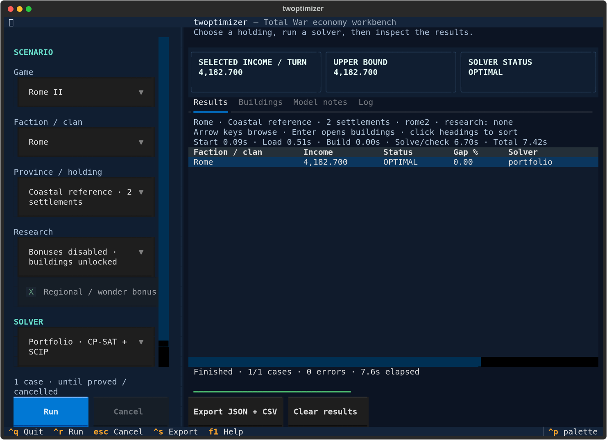

# twoptimizer

Find income-maximizing building layouts for **Total War: Attila, Rome II,
Shogun 2 and Three Kingdoms**. Compare factions and solvers, inspect results, and export JSON or CSV
from an interactive terminal UI or the command line. Bundled reference data lets
you run without a game installation.

## Quick start

Install [uv](https://docs.astral.sh/uv/getting-started/installation/), then:

```sh
git clone https://github.com/Napolitain/twoptimizer.git
cd twoptimizer
uv run --locked twoptimizer
```

`uv` automatically sets up Python and installs the locked dependencies. The
project requires Python 3.14 or newer; development and CI target Python 3.14.
CP-SAT is the default solver; HiGHS is the alternative in all four games.
Both backends come with the locked OR-Tools dependency.

Choose a game, faction and province in the terminal UI, then press **Ctrl+R** to
run. Use **Esc** to cancel, **Ctrl+S** to export, **F1** for help and **Ctrl+Q** to
quit. CPU selection is automatic. Solves run until optimality or infeasibility is
proved; enable **Use a time limit** for a bounded run.
Use **Multiple provinces…** for a searchable checklist with All/None controls.
Independent batches and joint holdings work in all four games. Joint Attila and
Rome II runs use bundled campaign borders automatically; **Neighboring provinces…**
lets you override them. **All** selects actual provinces; the joint mode shares
the game's applicable bonuses and constraints.
Three Kingdoms uses a separately labeled **historical 1.2.0 public reference**,
with city levels optimized by default, and explicit population and base corruption
inputs. Choose a fixed city level when comparing a particular settlement size. Its historical
map coverage is incomplete: joint runs at zero base corruption can proceed
because the modeled neighboring effects only reduce corruption. At positive
base corruption, supply the neighboring commanderies explicitly.
Use **Optional constraints…** to require or forbid specific buildings, set an
Attila religious-influence minimum, or choose Shogun 2 religion and Nanban contact.
These options retain the income objective and the game's modeled availability rules.
Enable **Compare income without requirements** to measure their income cost and
inspect changed buildings in the **Constraint cost** tab. Exact loss is reported
when both optima are proved; unfinished solves show bounds instead.
The query preview shows batch scope before Run. **Model size** displays compiled
variable and constraint counts, with separate reference and solver formulations.
During CP-SAT search, a separate live line shows the candidate income, upper
bound and remaining gap. A candidate becomes a result after validation.
Larger joint Rome II CP-SAT runs automatically prepare bounds from smaller
connected groups before searching the complete model. Shared food and all other
requirements remain enforced; the [measurement report](docs/rome-joint-bounds.md)
explains the method, observed results and limits.
Eligible joint Attila CP-SAT runs use a separate bound-preparation method for
provincial food and cross-province effects. Its
[measurement report](docs/attila-joint-bounds.md) shows improved income and bounds
within the tested allowance, alongside higher wall time and memory use.
Three Kingdoms joint runs can prepare validated local layouts and bounds from
connected groups. Shogun 2 can prepare a conservative local starting layout.
Preparation is automatic and bounded; it does not limit the subsequent unlimited
solve. See [joint preparation and reusable search](docs/joint-preparation.md).
Eligible Attila and Three Kingdoms holdings with eight or more provinces use
native CP-SAT multiplication automatically. Rome II and Shogun keep their existing
defaults; [paired measurements](docs/native-products.md) explain the selection
and the cases where native products were worse.
The **Runtime** tab shows matching historical measurements, timings from earlier
runs with the same settings in this session, and time since the candidate or
bound last improved. These are observations, not a promised completion time.
The same app session retains validated layouts and applicable bounds between
Runs, including after graceful cancellation. Run again to continue improving a
matching scenario; Force stop or exiting the app discards worker state.
Press **Cancel** once to stop CP-SAT search and retain its best candidate after
independent validation, including the remaining bound and gap. Later batch cases
will not start. **Force stop** (Cancel again) or Quit may discard the active
candidate. HiGHS may need to finish its current native solve before returning;
Force stop remains available. A stopped run without a candidate or proof is `UNKNOWN`,
not an infeasibility proof.

For HoI4, select **Inspect HoI4 data…** to browse the eight major countries,
starting armies, economic modifiers and states with mouse or keyboard.
The inspector shows source coverage and gaps;
the new hourly campaign optimizer is still being built.



## Command line

Run from the repository directory:

```sh
uv run --locked twoptimizer rome2 --faction rom_rome --layout coastal --seconds 15
uv run --locked twoptimizer shogun2 --clan oda --soil native --seconds 15
uv run --locked twoptimizer attila --province Thracia --fertility 5 --seconds 15
uv run --locked twoptimizer three-kingdoms --commandery Yingchuan --seconds 15
uv run --locked twoptimizer hoi4 data --country FRA
uv run --locked twoptimizer hoi4 data --country all --json --output hoi4-data.json
```

`--seconds` sets an optional per-case time limit; omit it to run to completion.
Add `--help` to any subcommand for its options, or run
`uv run --locked twoptimizer --help` to list commands. Comparison reports go under
`benchmark-results/` by default; use `attila --output results.json` to save an
Attila run.

## Details

Results optimize the stated static economic models and supplied inputs; they are
not complete campaign simulations. Three Kingdoms' historical reference is not
current-patch certification. HoI4 optimization is still under development.

- [Usage, scenarios, exports and model assumptions](docs/usage.md)
- [Rome II model](games/tw/rome2/README.md)
- [Shogun 2 model](games/tw/shogun2/README.md)
- [Three Kingdoms historical model, sources and limitations](games/tw/three_kingdoms/README.md)
- [Three Kingdoms solver validation and measured joint runs](docs/three-kingdoms-validation.md)
- [HoI4 development status, public data and hourly planning](games/hoi4/README.md)
- [Data preparation and coverage](games/tw/multigame/README.md)
- [CP-SAT and HiGHS comparison](docs/cpsat-highs-performance.md)
- [Joint Attila and Rome II performance investigation](docs/joint-scaling.md)
- [Rome II joint bounds and measured solution quality](docs/rome-joint-bounds.md)
- [Historical joint and independent holding benchmarks](docs/holding-performance.md)
- [Attila special-building audit](docs/attila-special-audit.md)
- [Rome II special-building audit](docs/rome-special-audit.md)
- [Agent and development guidelines](AGENTS.md)
