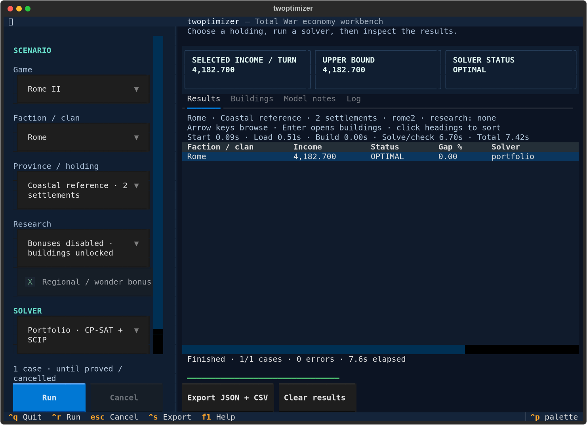

# Usage and model reference

[Quick start](../README.md) · Run the commands below from the repository root.

## Interactive terminal UI

Install once, then launch without parameters:

```sh
uv sync --locked
uv run --locked twoptimizer
```

Run all commands from the repository root. The CLI commands below remain available.



The Textual interface supports Attila, Rome II and Shogun 2. Choose a faction or
all factions, a province, research profile and solver with clickable,
searchable dropdowns. Attila adds fertility/religion; Shogun 2 adds soil, town
wealth and tax; Rome II offers regional bonuses and explicit research profiles.
The default is a Rome II coastal reference case using CP-SAT. The supported
solvers are **CP-SAT** and **HiGHS** in all three games.
Runs have **no time limit by default**: they continue until the solver proves
optimality or infeasibility. Cancel remains available. The optional **Use a time
limit** checkbox enables early termination when explicitly requested.
CPU selection is automatic for both solvers, respecting process affinity and
container quotas. The solver decides how much parallel work the model supports.
No worker count is required in the TUI; `--workers` remains an optional CLI override.
Three Kingdoms and HoI4 show their current readiness rather than starting an
unsupported optimization.

**Optional constraints…** opens a searchable building list. Choose a building by
name or exact ID, then **Require** or **Forbid** it; **Remove marked** deletes chosen
rules and **Clear all** clears these optional settings. **Apply** saves the
options; Cancel discards edits. Require means at least one copy of that exact
building level across a joint holding, while Forbid means zero copies. Independent
batches apply the same requirements separately to every province/faction/solver
case. Requiring one level does not accept a different upgrade level as a substitute.

Modeled faction, placement, religion, research and unique-building limits still
apply. Requiring a known unique building therefore forces its one allowed copy;
it does not permit duplicates. Catalog entries may be unavailable at the selected
locations or settings. An unavailable requirement produces an error or infeasible
case instead of unlocking the building. Attila's imported legendary limits remain
incomplete; advanced campaign rules can supply explicit caps. Rome II's excluded
level-5 monuments stay unavailable.

The same dialog offers game-specific religious settings:

| Game | Optional setting | Meaning |
| --- | --- | --- |
| Attila | Minimum state-religion influence in each province | Uses the faith selected in the main settings. The minimum is a scoped sum of influence effect points, not a population-adherence percentage or conversion forecast. Leave blank for no minimum. |
| Shogun 2 | State religion; Nanban contact established | Defaults to the clan's native faith with no contact. Faith selects eligible religious chains; Ikko requires Ikko Ikki and vice versa. Contact enables eligible Nanban candidates without requiring construction. Population conversion is not simulated. |
| Rome II | Require a temple by its building ID | The model has no separate state-religion or religious-adherence constraint. |

These optional restrictions leave income as the optimization objective. Without
them, existing default behavior is unchanged.

Enable **Compare income without requirements** to run the selected case and a
baseline with only the optional required buildings, forbidden buildings and
religious-influence minimum removed. Both runs retain the same faith, Nanban
contact, advanced campaign rules, world settings and available building choices.
For example, comparing a Christian Shogun temple requirement keeps Christianity
in both runs. Attila targets or building rules supplied through an advanced
campaign scenario also stay in both runs.

Select a completed row and open **Constraint cost** to inspect income with and
without those requirements and the added/removed buildings. The tab reports a
**proven income loss** only when both runs reach `OPTIMAL`. If feasible runs remain
unfinished, it shows bounds on the optimum income loss and separately labels the
observed difference between their current layouts. That observed difference can
be negative without proving an economic benefit from the requirements. Building
changes can also reflect tied alternatives. Missing feasible results produce an
unavailable comparison rather than an assumed zero cost.

Comparison is off by default. Enabling it can perform two solves for each case;
each receives the configured per-case time limit, if one was supplied. Without
active building or influence requirements, it performs no extra solve and reports
that there is nothing to compare. Normal run defaults remain unchanged.

- Mouse clicks, wheel scrolling, arrows, Enter and Tab/Shift+Tab navigate the UI.
- **Ctrl+R:** run; **Esc:** cancel the active batch; **Ctrl+Q:** quit.
- **Ctrl+S:** export JSON and CSV; **F1:** keyboard help and model-status meanings.
- Result rows show income, status, bound gap and timing. Click a heading to sort;
  select a row to inspect it, or press Enter to open its building layout.
- Compare exact solvers runs CP-SAT and HiGHS on the same selected
  holding. All-faction research runs explicitly list unavailable profiles.

The first **Cancel** or **Esc** requests a graceful stop and prevents later batch
cases from starting. CP-SAT stops search, independently validates its best
candidate when one exists, and returns the layout with its bound and gap. This
result can be inspected and exported alongside earlier completed cases. Without
a candidate or proof, the stopped result is `UNKNOWN`; it does not establish
infeasibility. If a proof completed before the stop took effect, its terminal
status remains valid.

While stopping, the button becomes **Force stop**. Pressing it (or **Esc** again)
terminates the active worker and may discard its candidate. Quit also terminates
the worker. During preparation or validation, a graceful request can take time
to reach a stopping point. The pinned OR-Tools 9.15 HiGHS backend does not honor
native interruption: Cancel still prevents later cases but can wait for the
current native solve; Force stop is available to end that wait.

Exports include scenario settings, source hashes,
assumptions and the original engine result. Reports default to
`benchmark-results/tui/`; the export dialog accepts another filename and protects
existing JSON/CSV files unless replacement is explicitly selected. Model notes
state each game's income definition and remaining data gaps. Values from different
games are not a common GDP ranking.

The status line shows engine startup, data loading, model building, solving and
validation. Finished rows include phase timings; JSON exports also retain solver
conversion/search/validation times. Attila and Shogun 2 exact solvers use sparse
constraints, avoiding a large mostly empty matrix (the ERE/Thracia case drops
from 153.5 MB to 0.49 MB of constraint storage).

CP-SAT now uses an exact linear formulation for Rome II, with bounds and product
constraints derived from the existing slot and branch limits. Attila factors
shared wealth/tax/corruption calculations when income contains cubic products;
simpler quadratic objectives keep the expanded Boolean model. Both paths retain
the original economic evaluator and independently validate the selected layout.

Historical Python 3.12 measurements with four automatically selected CPUs,
including repeated runs after integrating the engine API refactor (the project
now targets Python 3.14 and requires Python >=3.14):

| Case | Previous solver time | Revised solver time | Full TUI worker | Proven income |
| --- | ---: | ---: | ---: | ---: |
| Rome II: Rome, Italia, research disabled | Unproved after 20 s | 7.5–12.4 s | 8.1–13.0 s | 9,733.80 |
| Attila: ERE, Thracia, fertility 5, all technologies | 9.36 s | 0.34–0.38 s | 1.3–1.6 s | 24,140.375 |

These are same-machine measurements; parallel search timings vary. All revised
cases above ran without a time limit and finished `OPTIMAL`. Python 3.14 also
proved the same incomes: 9.5–11.6 s total for Rome/Italia and about 2.2 s for
ERE/Thracia. The broader
[formulation comparison](../reports/solver-formulation-comparison.json) includes
remaining hard cases: Iceni/Italia was still unproved after 20 seconds. Normal
runs continue to completion, with automatic CPU selection and cancellation.

The original province dropdown remains the default. **Multiple provinces…**
opens a searchable checklist: select any subset, use **All** or **None**, then
apply. Space toggles a highlighted item; filtering preserves hidden selections.
The selection runs for every chosen faction and solver. With none selected, Run
is disabled and completed results remain available. **Single province** returns
to the original dropdown; Cancel discards picker changes.

By default each province is optimized independently, with one result row per
province/faction/solver. **Optimize selected provinces together** instead creates
one joint holding per faction/solver in all three games. **All** selects named
provinces: 62 in Attila, 57 in Rome II and 65 in Shogun 2, excluding hypothetical
reference layouts. Attila shares faction
effects and applies adjacency bonuses across the selected map borders; its existing
province-level food, sanitation and order requirements still apply. Shogun 2 shares
food and enforces unique-building limits across the holding. Rome II shares food,
selects one political profile, keeps public order local, and applies factionwide
building and owned-world bonuses across the holding.

Joint Attila and Rome II holdings use the bundled campaign's borders between
selected provinces automatically. **Neighboring provinces…** shows these links and
lets you edit them. Add each custom border once: effects work in both directions.
Apply an empty list to explicitly model no adjacency effects, or choose **Use map
borders** to restore automatic selection. Automatic borders follow selection
changes; custom borders are pruned on removal and require review when provinces
are added. Shogun 2's map is also bundled, but its imported neighboring effects
concern religious conversion, outside the static full-adherence income model, so
its optimizer needs no border input.

JSON exports retain the province selection, joint mode and border inputs. Automatic
requests keep `adjacency: null`; `raw.map_context` records the resolved borders,
source details and limitations. CSV includes the effective adjacency, its mode,
and a direction flag; Attila campaign pairs retain source-to-recipient direction.
Nondefault optional settings are stored in each shared JSON `request.constraints`;
the matching CSV `constraints` column contains the same JSON object.
Comparison JSON stores the cost summary, changed buildings and full baseline
result under `raw.constraint_comparison`. CSV adds comparison status, baseline
income, exact cost when known, lower/upper cost bounds and the observed difference.
An empty bound or exact-cost field means unavailable, not zero.
The requested constraints are solved first, so cancellation can retain a layout
that meets them. If the baseline is unfinished or skipped, the comparison remains
bounded or unavailable; the retained layout never substitutes the relaxed baseline.
Graceful cancellation retains any independently validated current result and
earlier completed cases; Force stop may discard the active candidate. The CLI
retains campaign JSON inputs and its existing advanced options.
Installed wheels include the game data; a Git checkout is not required to run them.

The preview counts selected provinces, joint/independent mode, factions, solver
choices, expanded cases and automatic/custom borders before Run. It does not compile
models while editing settings. During a run, the activity area shows the latest
model's variables and constraints. The **Model size** tab separates reference
models from solver inputs and adds formulation, decision/auxiliary counts,
nonzero coefficients and constraint-matrix storage wherever those are known.
Reference counts appear after compilation; some native CP-SAT counts become
available after search. All counts describe inputs before presolve. Matrix storage
is not total solver RAM, and variable/constraint counts do not predict runtime.
Selecting a completed row restores its recorded counts; JSON exports retain them
under each case's `raw.model_complexity` without changing native solver metadata.

The TUI reuses one engine process across a batch, so independent cases pay Python
and native-library startup once. Each case still builds its own model. Solver CPU
parallelism comes from the machine's available cores and container allocation,
not the number of provinces. Later cases report dispatch time instead of another
startup time. Cancel requests a graceful stop before the batch ends; starting a
new batch creates a fresh process.

The CLI uses the same application service as the TUI. Existing commands and
comparison report formats remain available:

```sh
uv run --locked twoptimizer rome2 --layout coastal --seconds 15
uv run --locked twoptimizer shogun2 --soil native --algorithm cp-sat
uv run --locked twoptimizer attila --province Thracia --fertility 5 --seconds 15
uv run --locked twoptimizer attila-factions --help
```

All optimizer CLIs also run without a time cap by default. Omit `--seconds` to
run to completion; specify it only when you want an optional per-case time limit.
All application requests optimize income. The shared service applies the same
validation, scenario preparation and result semantics in either interface; CLI
comparison commands retain their broader batch defaults.

All three CLIs accept `--joint` and `--independent`. Rome II and Attila default to
independent cases; Shogun 2 retains its joint default. Use `--province all` for all
named provinces. Joint Attila/Rome II runs use bundled map borders unless overridden
by `--borders borders.json`, an explicit `--no-borders` sensitivity, or Attila's
campaign `adjacency` map. A border
file is a JSON list of pairs, for example `[["Italia", "Magna Graecia"]]` for Rome II;
names and IDs are accepted. Resume retains the original ownership mode.

```sh
uv run --locked twoptimizer rome2 --faction rom_rome --province all --independent
uv run --locked twoptimizer rome2 --faction rom_rome \
  --province Italia --province 'Magna Graecia' --joint
uv run --locked twoptimizer shogun2 --clan oda --province all --joint --soil native
```

All three CLIs accept repeated `--require-building ID` and `--forbid-building ID`.
Use the exact IDs shown in the TUI's optional-constraints catalog. For example:

```sh
uv run --locked twoptimizer attila --province Thracia --religion CHRIST_ORTHODOX \
  --require-building att_bld_religion_orthodox_major_1 --minimum-religious-influence 5
uv run --locked twoptimizer rome2 --faction rom_rome --province Italia \
  --require-building rome_religious_jupiter_3
uv run --locked twoptimizer shogun2 --clan oda --province jap_owari \
  --province jap_settsu --joint --soil native \
  --religion buddhist --require-building sho_buddhist_4_legendary_temple
uv run --locked twoptimizer shogun2 --clan oda --province jap_settsu --soil native \
  --religion christian --nanban-contact --require-building sho_port_3_nanban_trade_port
```

Attila's `--minimum-religious-influence POINTS` requires the selected faith's
influence minimum in every selected province. Its existing `--religion` chooses
the faith. Shogun's `--religion buddhist|christian|ikko` overrides the clan default;
`--nanban-contact` supplies contact without forcing a port. A Buddhist clan may
convert to Christianity in this static scenario, but Ikko's clan restriction
remains enforced. Neither option simulates the conversion process.

Rome II and Shogun CLI JSON reports retain the optional constraints alongside
their scenario/results. When resuming a Rome II report, repeat the original
constraint flags; resume rejects changed or omitted nondefault constraints.
These examples run to completion unless you add an explicit `--seconds` limit.

All three optimizer CLIs support `--compare-constraints`:

```sh
uv run --locked twoptimizer rome2 --faction rom_rome --province Italia \
  --require-building rome_religious_jupiter_3 --compare-constraints
```

The CLI prints a proved cost or unresolved bounds and preserves both sides in
the report. The [worked comparison examples](constraint-cost-examples.md) show
actual CLI and worker results for all three games, including a zero-cost
requirement. Repeat `--compare-constraints` when resuming a Rome II comparison;
resume cannot change comparison mode. A comparison whose income cost remains
unproved is retried on ordinary resume even if the constrained case is optimal.
`--fill-missing` retains existing cases and only fills absent ones.

An all-province joint problem maximizes the selected realm's total income. An
independent batch solves a separate hypothetical realm for each province; adding
those results does not enforce shared food, uniqueness or cross-province bonuses.
Joint problems can take longer to prove optimal. Cancellation and optional time
limits remain available; no limit is imposed by default. The configured time
limit is a solver allowance, not a wall-clock deadline. Some backends charge model
conversion against it; loading, compilation and result validation can make total
wall time exceed it.
Cancel can also be requested during preparation; Force stop ends the active
worker if waiting for a graceful stopping point takes too long.
During CP-SAT search, the TUI shows candidate income, the upper bound, the gap
and elapsed search time separately from completed, validated results. Solver
model counts arrive before search begins. These observations do not impose a
time limit or change the objective. A live candidate becomes a saved result only
after independent validation, including when CP-SAT returns it following a
graceful Cancel. The retained bound and gap describe unresolved proof work.
A 2% gap describes the upper bound's remaining allowance; the layout may already
be optimal. It does not prove that another layout earns more.
The **Runtime** tab adds time to the first observed candidate and the age of the
last layout and bound improvements. Its clocks keep advancing during quiet
search. Before Run, the runtime outlook uses narrowly matched historical
benchmarks where available, including unfinished measurements; reference
hardware, solver allowance and older-build limitations remain visible.
Earlier runs with exactly the same settings in the current TUI session provide
additional timing context. This bounded in-memory history survives **Clear results**
and is discarded when the app exits. Cancelled and time-limited unfinished runs
are recorded separately from optimality/infeasibility proofs. Comparisons require
both sides to finish their proofs. Partial batch history never extrapolates the
remaining cases. HiGHS currently has no live candidate/bound telemetry.
Neither model size, gap nor a quiet interval predicts whether a proof will take
minutes, hours or weeks. The outlook reports **unknown** without matching evidence;
past completion times are not an ETA or a new time limit.
The [joint-model investigation](joint-scaling.md) records reductions in model
construction time and the remaining difficulty of proving full-world optima.
The [CP-SAT/HiGHS comparison](cpsat-highs-performance.md) records the supported
backends on paired provinces. The [earlier holding report](holding-performance.md)
also covers all provinces and retired backends. Both retain resource limits and
unfinished results; those limits are benchmark settings, not application defaults.

For a measured all-65-province Shogun 2 case (Oda, all arts, native soil,
CP-SAT, one solver worker), independent TUI batches fell from **39.59 seconds**
with a subprocess per case to **1.72–1.75 seconds** with one reused process.
The joint holding took **8.47 seconds**. Every case finished `OPTIMAL`; per-case
income and metrics were unchanged by process reuse. Automatic CPU selection
chose four workers on this machine and finished the independent batch in
**1.90 seconds**. These are same-machine observations, not runtime guarantees.
The [measurement record](../reports/tui-batch-performance.json) includes settings,
timings and reproduction steps.

Independent cases have only 44–76 variables each in that Shogun example. Summed
across cases, they have 3,491 variables and 5,616 constraints; the joint model has
3,491 variables and 5,360 constraints but a harder connected search. Shared food,
building limits and bonuses matter more than raw counts alone. Attila and Rome II
support all-province joint inputs too, but their full-map time to proven optimality
has not been established. A two-province Attila sample proved both independent
cases in 2.96 seconds while the joint case remained only `FEASIBLE` at its
five-second limit. Rome II pair samples remained unproved in both modes at that
limit; independent cases each received a separate limit, so those capped totals
do not establish a speed comparison.

### Bundled campaign geography

| Game | Land regions | Provinces | Regional borders | Province borders |
| --- | ---: | ---: | ---: | ---: |
| Attila | 186 | 62 | 388 | 108 |
| Rome II | 173 | 57 | 353 | 100 |
| Shogun 2 | 65 | 65 | 103 | 103 |

Attila and Rome II borders come from the vanilla raw hex maps in the
[pinned CampaignMapToolkit archive](https://github.com/TW-Campaign-Map-Modding-Team/CampaignMapToolkit/tree/d7e27bacaf9a5b4656b483b47b4e6212ad3a6cb4/Templates),
whose README credits OtherTomCA for the raw maps. All map region IDs match the
optimizer catalogs. Attila's 108 province borders also agree exactly with the
[published campaign map](https://twdatabase.com/attila/map). A single regional-edge
swap between those sources is retained in the audit metadata; both versions
connect the same two provinces. Canonical regional borders use the raw hex map.

Shogun's graph comes from explicit `CAI_REGION_BOUNDARY` records in two pinned
public calendar-mod campaign files:
[Complete Edition calendar pack](https://github.com/xUHOx/SHOGUN2-CE-MOD/blob/fcaa47d2354cec7176d3fb6487b789238f82f1de/twelve-turns-per-year.pack)
and [older calendar pack](https://github.com/PiTatva/Shogun2X/blob/98024206b891a3a4013a7c6b341f6e29bc638318/edited_mods/mod_Extended_Years_Months.pack).
All 65 region IDs, 103 edges and their flags agree across both extracts. Numeric
boundary kinds remain explicit, including the two nonzero-kind edges, without
inventing their undocumented enum meanings. The
[encyclopedia map](https://shogun2-encyclopedia.com/regions.html) contributes all 65
display polygons; display geometry and engine coordinates are kept separately.

Each `games/tw/<game>/data/campaign_map.json` records source URLs, checksums,
coverage and limitations. Attila/Rome include separate water/coastal contact data;
those contacts are not travel routes or trade connectivity. The border defaults
describe the imported source maps, including impassable terrain contacts. They
are not certification of an installed patch or every effect's in-game recipient
rules. Only the supported base campaigns are covered; DLC maps are separate.
Source-specific rebuild commands are documented with the Rome/Shogun models;
Attila's factual snapshots rebuild offline with:

```sh
uv run --frozen python -m games.tw.attila.tools.import_map
```

### Regional and worldwide coverage

| Game | Neighboring effects | Special sites and shared effects |
| --- | --- | --- |
| Attila | Imported adjacent economic effects use bundled borders or overrides; conditional food-routing effects still need recipient inputs | Resource and church sites, factionwide modifiers, and explicit scenario construction restrictions; incomplete legendary metadata is disclosed |
| Rome II | Imported adjacent food effects count owned recipient regions | Resource settlements, Marib-only dam, shared faction building bonuses and owned regional/natural wonders; 35 level-5 legendary entries remain excluded pending unlock/limit/first-builder rules |
| Shogun 2 | Religious zeal is recognized but conversion is outside current income | All 65 province specialties/soils/ports, local special buildings, worldwide arts, shared food and legendary/Nanban limits |

The [Rome II special-building audit](../games/tw/rome2/data/special_buildings_coverage.json)
records the missing rules and the official construction-manual evidence. These
coverage limits matter when interpreting an optimum as a campaign result.
The latest [Rome II evidence review](rome-special-audit.md) expands the per-building
requirements audit without enabling any of the 35 excluded level-five buildings.
The [Attila evidence review](attila-special-audit.md) identifies a missing
faction-capital restriction for some legendary civic buildings; exact vanilla
per-ID flags remain unavailable. Current Attila layouts can therefore overstate
attainable campaign income. No new legendary unlocks or guessed caps were added
by these audits.

## Run Rome II

```sh
uv run --locked twoptimizer rome2 --layout coastal --seconds 15
uv run --locked twoptimizer rome2 --faction rom_rome \
  --layout coastal --algorithm cp-sat --algorithm highs
```

The [Rome II model](../games/tw/rome2/README.md) uses raw repository effects and
online building/research references. It handles shared food, province-wide
wealth bonuses, public order, distinct primary/port/ordinary plots, resource
cores, faction traits and one political profile. Solver bounds accompany
unfinished proofs. Its reference holdings have explicitly supplied resources
and slots; historical starting worlds and current patch fidelity are not assumed.

## Run Shogun 2

```sh
uv run --locked twoptimizer shogun2
uv run --locked twoptimizer shogun2 --soil native \
  --algorithm cp-sat --algorithm highs
```

The [model and assumptions](../games/tw/shogun2/README.md) cover jointly owned
provinces, native soils and specialties, castle-dependent town slots, shared
food, local order, religious chains, unique buildings, farm bonuses and tax
modifiers. This is a static current-income comparison with supplied town wealth,
not a full campaign or long-term growth forecast. Public references still need
validation against the installed build.

## Run Attila

```sh
uv sync --locked
uv run --locked twoptimizer attila --province Thracia --fertility 5 \
  --seconds 60 --output benchmark-results/thracia.json
```

The default solver is native CP-SAT. The default scenario uses Eastern Roman
Empire buildings, Orthodox religion, level-4 cities, all available nonmilitary
building levels, all technology effects, and the **income** objective. Income is
the only application objective; `--objective income` is accepted explicitly. Technologies
that disable legacy unlocks are respected. Without `--province`, the runner
covers all 62 map provinces at fertility 0 and 5; these are hypothetical owned
provinces, not the faction's starting territory.

The JSON contains selected buildings and per-region wealth, food, sanitation and
fertility; province public order; solver status, objective and bound; data
fingerprint; and an explicit list of unmodeled effects. Auxiliary product variables
are excluded from the building list. Every candidate layout is checked against
the compiled constraints and the separate layout evaluator.
`layout.finances` separates gross wealth, tax bonuses, corruption losses,
building upkeep, trade, tribute/subsidies and recurring net income.
`faction_traits`, `imported_modifiers` and `catalogue_exclusions` expose the
active facts, conditional inputs and missing building metadata.

`OPTIMAL` means the solver proved the optimum of this stated model. `FEASIBLE`
means an incumbent was found with a remaining bound; `INFEASIBLE` is a proof that
the selected requirements cannot all be met. `UNKNOWN` means the time budget
expired without a usable result. No result is labeled optimal just because it
matches another algorithm's score.

### Income and scenarios

Income applies tax/corruption assumptions and building modifiers, subtracts
imported upkeep, and adds supplied trade, tribute and subsidies. Defaults use a
neutral tax multiplier of 1, zero corruption and no external revenue. ERE's +8%
provincial governor tax bonus counts here; treasury interest is excluded. The
result is recurring income under the supplied static scenario.

The CLI rejects `--objective wealth`, `--objective legacy` and nonempty campaign
`weights`. Campaign targets remain available as constraints while maximizing
income.

```sh
uv run --locked twoptimizer attila --province Aegyptus --fertility 3 \
  --region-fertility Alexandria=5 --seconds 60 --output benchmark-results/mixed.json
uv run --locked twoptimizer attila --province Thracia --fertility 5 \
  --technology 'Roman Ethics' --technology 'State Maintenance' --seconds 60
uv run --locked twoptimizer attila --province Aegyptus --fertility 5 \
  --objective income --seconds 60 --output benchmark-results/income.json
```

Technology arguments use the imported display names. Repeated `--technology`
arguments define the researched set; `--no-technologies` defines an empty set.
No technology arguments means all imported technologies are researched, except
legacy technologies disabled by subsequent research. Imported tax, wealth,
corruption and public-order technology effects apply automatically. Requirements stay
specific to the culture. Missing metadata raises an error when a requested
restriction cannot be checked; it is never interpreted as a free building.
In income mode, buildings without imported upkeep/availability metadata are
excluded and listed by name in `catalogue_exclusions`. This is a known coverage
gap, not a claim that those buildings are unavailable in the game. The original
tables are retained.
Fertility is an explicit scenario input; historical regional fertility has not
been imported or inferred from a modern map.

## Effect handling

`games/tw/attila/effects.py` defines recognized effect kinds and scopes.
`games/tw/attila/economy.py` evaluates and compiles them. Original effect IDs,
amounts and raw scope strings are retained, including effects outside this model.
Unsupported military effects no longer cause an entire building to be deleted.

* Building bonuses affect their producer only; regional bonuses affect the
  specified region; province bonuses affect the appropriate receiving regions.
* Category bonuses affect the matching wealth categories. For example, industry
  bonuses do not boost farming, while commerce bonuses include land and maritime
  commerce where the effect explicitly targets both.
* Wealth-category bonuses stack additively. Products between selected buildings,
  their bonuses, fertility changes and optional tax modifiers are represented
  with exact Boolean-product constraints. Rational arithmetic is used before
  export to avoid floating-point coefficient artifacts.
* Local sanitation applies once to its own region; province sanitation applies
  once to every region. Two canals with +3 local and +4 province sanitation give
  11, 11 and 8 sanitation in a three-region province.
* Province and faction public order contribute once per receiving province,
  rather than once per region. Immigration penalty percentages are not treated
  as flat public-order losses.
* Faction bonuses can affect all owned provinces passed to one `Problem`.
  Adjacent-province effects use the supplied adjacency mapping in a joint problem.
  Conditional food-sharing effects use explicit recipient maps rather than an invented food-import rule.
* Horde structures are excluded from settlement slots. Religious building
  eligibility follows the selected faith.

Imported `source_tree_group` values describe the source's building-tree display;
they are **not exclusivity constraints**. The existing per-branch level exclusions
remain in place, allowing different branches to coexist. Complete building
availability and slot rules still need validation against the running game.

The API defaults to CP-SAT through `Problem(context=parser.context)`. Use
`Problem(context=parser.context, solver=SolverType.HIGHS)` for HiGHS, or
`SolverType.CP_SAT` explicitly (`SolverType` is in `games.tw.enums`).
`Problem(context=parser.context, technologies={...})` restricts technologies.
`Problem(context=parser.context, adjacency={province_id: [neighbor_id, ...]})`
supplies neighboring owned
provinces; include their decision variables in the same problem. The CP-SAT
adapter exposes its status and bound through `problem.problem.result`; its default
search has no time cap and selects CPU parallelism automatically. Explicit limits remain available
through the backend API. LP/MPS exports remain available.

## Refresh the online data

No installed game is needed for the checked-in snapshot or the online importer.

```sh
uv run --locked python -m games.tw.attila.tools.import_online
uv run --locked python -m games.tw.attila.tools.import_factions
uv run --locked python -m games.tw.attila.tools.import_modifiers
uv run --locked python -m games.tw.attila.tools.audit_data
```

The importer reads all 11 culture pages at
[TW Database](https://twdatabase.com/attila/buildings). The checked-in snapshot
contains 566 matched building records: construction cost, construction turns,
upkeep, culture-specific technology requirements and normalized numeric economic
observations. No artwork, descriptions or executable code is imported.

Identity matching requires an unambiguous combination of an existing icon key
and building name. Ambiguous entries are listed under `unresolved`, never guessed.
Requirements from different cultures are preserved separately. Conflicting core
metadata is reported and excluded. The importer checks each page's declared game
build and refuses to mix builds. The snapshot declares Steam build 25370302;
the original TSVs have no recorded patch version, so we do not assert they share
that version.

`online_buildings.json` records source URLs, response SHA-256 hashes, import time
and verification status. `effect_audit.json` enumerates every original
(effect ID, scope) pair, its handling status and source comparisons. The current
cross-check has 6,242 matching numeric observations, including percentage bonuses,
and no disagreements for the Eastern Roman culture. Other reported differences
include horde/migration scope contexts; the original effect table is never
silently overwritten.

`online_factions.json` adds 140 Grand Campaign faction entries from
[Honga](https://www.honga.net/totalwar/attila/faction.php?f=att_fact_eastern_roman_empire&l=en).
Ruling-party and shared culture effects are retained separately from opposition
party effects. `online_modifiers.json` adds all 29 playable faction technology
trees and all 14 state religions from [TW Database](https://twdatabase.com/attila/religions).
Those pages declare the same Steam build as the building snapshot; Honga does
not declare a patch version. Their facts are references, not in-game validation.
Both importers cache responses and support `--offline`; unexpected formats fail.

Responses are cached in `.cache/attila-online/` (git-ignored). Replay without
network access with `--offline`. To fetch a fresh source snapshot, choose a new
cache directory:

```sh
uv run --locked python -m games.tw.attila.tools.import_online \
  --cache .cache/attila-online-refresh
uv run --locked python -m games.tw.attila.tools.import_online \
  --cache .cache/attila-online-refresh --offline
```

The importer fails if the upstream format changes. Re-run the audit and tests
before accepting refreshed data. These are third-party reference checks, not
in-game validation. The source's game data remains attributable to its owners.
For a future authoritative local export, [RPFM supports TSV export](https://frodo45127.github.io/rpfm/manual/editors/db.html).

## Compare solvers

```sh
uv run --locked twoptimizer attila --limit 6 --seconds 5 \
  --algorithms cp-sat highs --output benchmark-results/comparison.json
```

Both solvers optimize the same economic rules. CP-SAT uses exact decimal integer
scaling; HiGHS solves the linear mixed-integer formulation. Returned layouts are
checked against the model and independently evaluated. Both can return feasible
layouts before proving optimality when an explicit time limit is enabled.

Timing includes each solver's private model conversion and search. Shared engine
compilation is recorded separately. Limits are cooperative; validation and solver
shutdown add overhead. Repeat measurements with the same scenarios and machine
before drawing performance conclusions. Supporting two solvers reduces the
maintenance surface; it does not assert that one is fastest on every model.

CBC, SCIP, the portfolio, GLOP and heuristic solver modes are retired. Current
requests must name `cp-sat` or `highs`; rerun an old request with one of those
solvers into a new report. Remove retired `beam_width` and `restarts` settings
from older serialized Attila requests. Historical reports retain their original solver names,
results and timings. Historical benchmark reproduction requires the recorded
revision and dependency lock, not the current checkout. Generated new results
are kept under the git-ignored `benchmark-results/` directory.

## Scope and validation

This is a static settlement-building optimizer. It enforces nonnegative building
food and public order and at least one net sanitation point per region unless
scenario thresholds specify otherwise. Growth, research, religious influence,
resources and recruitment capabilities can be minimum targets while income is
maximized; the model does not simulate their evolution over time. It does not simulate
construction queues, upgrade histories, battles, population conversion, trade
diplomacy or the full campaign economy. Imported construction times remain catalog
facts. City capacity still follows the existing level-4 slot assumptions;
lower-city scenarios need further validation. Script-driven unlocks and several
hidden flags remain unmodeled. The effect audit identifies these explicitly.

The tests cover independently calculated scope examples, stacked sanitation,
category modifiers, fertility interactions, exact Boolean products, exhaustive
small optimization problems, legacy regressions, source format changes, ambiguous
identities, culture-specific requirements, mixed-build rejection and offline
imports. The HoI4 tests remain in the suite. The separate Rome II engine uses
the bundled named-province resource and regional-modifier catalogs.

Historical wealth and legacy benchmark measurements remain in Git history. They
do not describe the current income-only application.

## Campaign inputs and targets

Pass `--scenario path.json` to use campaign inputs. These two checked-in examples
use supplied assumptions, not imported historical starting conditions:

```sh
uv run --locked twoptimizer attila --province Aegyptus --fertility 5 \
  --objective income --scenario games/tw/attila/scenarios/campaign-income.json \
  --workers 8 --seconds 60 --output benchmark-results/campaign-income.json
uv run --locked twoptimizer attila --joint --province Aegyptus --province Aethiopia \
  --fertility 5 --scenario games/tw/attila/scenarios/joint.json --workers 8 --seconds 120
```

`--joint` puts all selected provinces in one optimization problem. Faction bonuses,
research targets, export revenue and adjacency are then coupled. Faction tariffs
are counted once, not once per province. Without `--joint`, each province is an
independent scenario; inputs that refer to unselected places are rejected.
The shared application equivalent is a `RunConfig` with `provinces`, `joint=True`
and `AttilaOptions(campaign=Scenario(...))`, passed through `make_jobs` and
`solve_case`. Bundled borders apply when adjacency is omitted; explicit campaign
or border inputs take precedence. Direct engine use
can also pass all participating provinces to `Problem(context=parser.context,
scenario=...)`.

The JSON keys are:

| Key | Meaning |
| --- | --- |
| `provinces` | Province IDs mapped to base `corruption_percent` (0–100), baseline `tax_percent` (default 100), nonpositive `immigration_order`, fixed `public_order`/`food`, and `minimum_food`/`minimum_public_order` |
| `regions` | Region IDs mapped to category/all `wealth_percent` bonuses, baseline `immigration_wealth`, fixed `food`/`sanitation`, and `minimum_sanitation` |
| `external_effects` | Fixed governor/edict/technology effects: recognized `effect` ID, raw `scope`, `amount`, and source `region`; these are constants, not selectable buildings |
| `base_tariffs` | Baseline faction tariff revenue, before building tariff modifiers |
| `resource_prices` | Revenue per exported resource unit; used only for the income objective |
| `resource_demand` | Optional export-volume caps; surplus units have no export value |
| `adjacency` | Source province IDs mapped to adjacent selected province IDs; lists are explicit and directed |
| `building_rules` | Explicit construction restrictions: `buildings` lists exact IDs, optional `minimum` and `maximum` bound their combined count across the holding, and `regions` optionally restricts placement |
| `conditional_targets` | Effect IDs mapped to source-province/recipient-province lists for exceptional food-sharing/neighbor effects |
| `targets` | Minimum required scoped effects: `metric`, `scope`, `target`, `value` |
| `weights` | Must be absent or empty; the application optimizes income only |
| `projects` | Fixed future project quotes: `region`, `base_cost`, optional `name`, `sanitation`, `conversion` |
| `project_budget` | Maximum total quoted cost of those future projects under the selected operating layout |
| `campaign` | Optional `province_capitals_held`, `active_trade_routes`, `base_tribute`, `at_peace_with_sassanids`, and explicit `poor_fertility_regions` |
| `faction_traits`, `technology_effects`, `religion_traits` | Booleans, default true; disable individual imported modifier sources for controlled comparisons |

Resource names include wood, wine, iron, lead, leather, marble, olive, salt, silk,
spice, dyes, gem and cloth. Prices and demand are supplied by the scenario; the
optimizer does not invent world-market prices or trade partners.

`building_rules` can require a building or bound several upgrade variants sharing
one count. For example, a supplied rule
`{"buildings":["att_bld_roman_east_civic_governor_5_legendary"],"minimum":1,"maximum":1}`
requires exactly one selected instance across the holding. Omitting `minimum`
allows zero copies; `maximum: 0` forbids the listed buildings. Counts are
nonnegative integers and the minimum cannot exceed the maximum. This is a scenario
assumption, **not an imported vanilla cap**; reports label it
`user_supplied_campaign_rule`. Unknown IDs, unselected regions and invalid limits
are rejected. These rules restrict available candidates; they cannot enable a
building whose upkeep or availability metadata is missing.

The income model restricts patriarchal church chains to the five church sites
and uses the selected religion's chain. Zafar's special dam slot is distinguished
from those church sites. The Attila Ma'rib Dam still lacks enough imported upkeep
and availability metadata for inclusion in income optimization. Factionwide
legendary effects are applied for available candidates, but exhaustive vanilla
legendary construction caps are not yet imported.
Earlier Attila comparison tables predate the church-placement correction. Rerun
Catholic/Arian holdings with patriarchal sites before treating those historical
rows as results of the current model.

Corruption modifiers are relative reductions of the supplied base corruption,
not percentage-point deductions: 50% corruption with a -20% modifier becomes 40%.
Relative modifiers stack additively before application to the base value.
Effective corruption is clamped to [0,100]. Tax multipliers cannot become negative.
Immigration order modifiers scale the supplied negative penalty and cannot turn
it into a bonus; immigration wealth modifiers scale the supplied wealth input.
The scenario must supply these baselines because they cannot be derived from
building data alone. Category wealth bonuses from external effects are scoped
through the same evaluator as building bonuses.
`provinces.*.religious_order` supplies a nonpositive religious-unrest baseline;
researched reductions scale that penalty, rather than becoming flat public order.
Project quotes can specify `main_settlement: true` or a `category` of `main`,
`civic`, `agriculture`, `industry`, `religious` or `military`, so imported
construction discounts affect the appropriate future project only.

Construction projects use general construction discounts plus sanitation discounts
when applicable. Conversion projects use conversion discounts. Costs cannot go
negative. These are quotes for **future projects under a selected operating
layout**. They do not establish that the layout could finance or build itself,
and do not simulate a construction order or treasury cash flow.

Examples of metric names are `growth`, `research_percent`, `resource:wood`,
`religion:orthodox`, `osmosis:orthodox`, `agent_enable:spy`, `agent_cap:dignitary`,
`agent_xp:spy`, `recruitment_points`, `recruitment_xp:infantry`, and
`equipment:armour:gold`. The complete set is `METRICS` in `effects.py`.
`scope` is `region`, `province` or `faction`; the `target` is its exact ID
(or `faction`, which may be omitted). Regional effects aggregate over recipient
regions, provincial capabilities over recipient provinces, and global research
and agent caps once per contributing source. Agent recruitment enablement is
Boolean, so two spy-enabling buildings do not enable two distinct spy types.
State-religion influence joins the selected faith; `religion:state` and the
selected faith's specific metric are aliases.

These metrics measure effect totals/capabilities, not time forecasts or battle
outcomes. A research-rate target does not guarantee that a technology finishes
by a date. Religious influence/osmosis targets do not predict future population
shares or unrest. The older `priorities.json` example contains objective weights
and remains a lower-level engine fixture; remove its `weights` entry to use its
minimum targets with the income-only application.

Conditional recipients currently support
`att_effect_public_order_base_neighbouring` and
`att_effect_food_production_fertility_neighbouring`. The input declares where the
condition holds; the model does not infer campaign food-routing conditions.
Unknown keys, nonfinite numbers, invalid IDs and unsupported metrics are rejected.
JSON reports include achieved metric targets, corruption, export revenue, project
cost, and the active scenario inputs, alongside the existing regional breakdown.

### Coverage after adding options

The audit distinguishes options from automatically modeled quantities:

| Status | Effect/scope combinations |
| --- | ---: |
| Core modeled economy | 37 |
| Economic scenario options | 8 |
| Scoped metric targets/preferences | 86 |
| Supported with adjacency input | 5 |
| Supported with explicit conditional recipients | 2 |
| Still unmodeled | 10 |
| Outside the settlement model (mostly army/horde) | 65 |

The unmodeled settlement combinations fell from 103 to 10. The remaining entries
include hidden trade-route flags, faction/script mechanics, wall/artillery flags,
imperium and agent-defense mechanics. This expansion does not claim to simulate
those or the 65 army/horde combinations. Run the audit to inspect each exact ID.

The corruption interpretation is corroborated by the [in-game effect tooltip for
Aksumite Monks’ Quarters](https://www.honga.net/totalwar/attila/building.php?b=att_bld_eos_religion_east_church_major_faction_1&f=att_fact_axum&l=en&v=attila), which describes a percentage of the current value.

The checked-in scenario examples also serve as engine regression inputs.
Validation checks the model and its supplied inputs, not complete in-game fidelity.

## Compare civilizations by recurring income

```sh
uv run --locked twoptimizer attila-factions --seconds 15 --workers 8
uv run --locked twoptimizer attila-factions --resume --seconds 60 --workers 8
```

The default comparison covers all 27 settled playable factions in Aegyptus,
Thracia and Germania, with fertility 5, common Orthodox religion, level-4 cities
and researched technology effects. Huns and White Huns are explicitly excluded
because settlement slots cannot represent a horde economy. Migratory factions
are compared after settlement. Each province is an independent hypothetical
holding: the default capital count is the number of selected capitals, not the
faction's historical holdings. `--all-factions` also includes NPC aliases; their
technology profile uses a labeled culture representative when an individual tree
was not imported. Repeated `--province` and `--religion` change the scenario.

The report writes an income table as CSV and JSON with layouts, income breakdowns,
bounds, source hashes, exclusions and unsupported effects. Identical compiled
models can share an optimality proof; every reused layout is validated against
the receiving model. `--resume` reruns unfinished proofs without repeating proved
cases. These are optimums of the declared model, not full campaign rankings.

The checked-in [income table](../reports/attila-income-comparison.csv) and
[assumptions and bounds](../reports/attila-income-comparison.json) record this run:
81 optimal province/faction cases, with 27 unpriced building variants disclosed.
The full generated layouts are in `benchmark-results/factions/income.json`.

The [fertility comparison](../reports/attila-fertility-comparison.csv) reoptimizes
these factions at fertility 5 and 1 and ranks their mean income across the same
three provinces. Its [inputs and proofs](../reports/attila-fertility-comparison.json)
record 162 optimal model cases. The fertility-1 Burgundian scenarios explicitly
enable Harsh Sustenance (+15 food per qualifying region); their missing curing
building metadata remains a limitation. Ties share rank, with gaps afterward.

Automatically applied economic traits include ERE tariffs, Garamantian fertility,
desert sanitation, Venedian farming bonuses, removal of farm order/squalor
penalties, other wealth penalties, and
Eastern sanitation per owned province capital. Aksum's trade income modifier is
applied after tariff/export income. Its food bonus needs `active_trade_routes`;
Sassanid tribute needs `base_tribute`; Lakhmid peace income needs an explicit peace
state. Poor-fertility food recipients are explicit because the source does not
give a numeric fertility threshold. Religious unrest and public-order bonuses
depending on religious presence are not inferred from influence points.

Important gaps remain: some unique/legacy buildings lack imported metadata;
some faction scripts and religious-presence effects are unmodeled; starting
territories, governors, edicts, difficulty, trade partners, military expenses,
construction sequences and cash flow require further campaign inputs/modeling.
The audit now includes faction, technology and religion fact coverage alongside
the original building-effect coverage. The solver does not assert exhaustive
Attila simulation.
